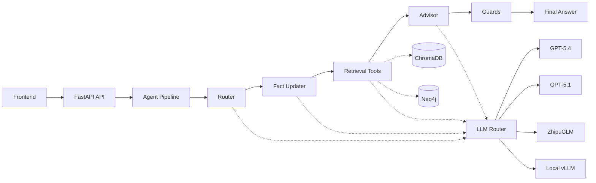

# Legal Agent V3

## 个性化法律工作台文档

- 进展文档：[docs/personalized_workspace_progress.md](docs/personalized_workspace_progress.md)
- 答辩提纲：[docs/defense_outline.md](docs/defense_outline.md)

当前 `feat/personalized-legal-workspace` 分支已经形成个性化法律工作台闭环，包括：

- mode consent 与 `temporary / tracked / unknown` 持久化边界
- Dossier 案卷模型、会话绑定、手动摘要与智能摘要
- dossier_context / dossier_graph_summary 注入 advisor
- 会话图谱、案卷图谱聚合、participant resolution 与 schema hardening
- canonical 案卷主体工作区：已连接主体、跨会话同一主体确认、高置信待确认、手动合并与来源会话跳转
- 图谱写入前的语义写入守卫：GPT-5.1 优先审查 `我 / 当事人 / 他 / 公司` 等泛称、跨会话承接授权和非责任体分类，规则层作为最终契约兜底

## 项目简介

法律智能问答和通用聊天问答不同，它对真实性、可解释性和稳定性要求更高。系统不仅要“会说”，还要尽量避免法条幻觉、金额乱算、案例乱引，以及多轮对话中事实丢失等问题。对于劳动争议、合同纠纷、婚姻家事、民间借贷、工伤赔偿、刑事咨询等场景，这些问题都会直接影响回答质量。

Legal Agent V3 面向上述场景，采用 RAG 检索、多模型路由、安全 guard 和 benchmark 闭环评估的组合方案。系统先维护案情事实，再检索法条和案例，最后在 grounded prompt 与守卫机制约束下生成回答，目标不是模板式润色，而是基于检索材料进行 grounded legal reasoning。

在最新全量 benchmark 中，系统总分从 G 系列前基线的 55/80 提升到 65/80，即从 68% 提升到 81%，整体提升 10 分、13 个百分点。结果表明，多轮连贯性、可操作性和系统稳定性都有了可量化改善。

## 系统架构



架构上，系统把“事实维护、检索、生成、守卫”拆成独立环节。ChromaDB 负责法律法规和案例的向量检索，Neo4j 保留法条引用图谱 C1 数据资产；LLM Router 根据任务类型分配模型；Advisor 负责最终法律推理；Guards 负责法条真实性和金额安全约束。

## 核心改造：从模板拼装到 grounded RAG 法律推理

Surgery G 系列的核心变化，是把 LLM 从“文本精校员”升级为“基于 RAG 的法律推理器”。旧版本的主要问题不是系统不会检索，而是检索到材料后，模型仍然更像在拼接模板和润色措辞，导致法条引用不稳、多轮连续性不足、遇到金额问题时不够可控。

新方案中，payload 只负责提供权威数字和已确认事实，RAG 提供法条和案例依据，advisor 通过三段式 grounded prompt 完成回答，guards 则负责 fabricated statute 检测、phantom citation stripping 和 warning 提示。这样一来，回答的依据链条更清晰，也更适合做 benchmark 验证和答辩展示。

| 旧版本 | 新版本 |
|---|---|
| 模板驱动 | grounded RAG 推理 |
| LLM 只润色 | LLM 做法律分析 |
| 法条可能幻觉 | phantom citation guard |
| 多轮记忆不稳定 | fact_updater + case_summary |
| 单模型调用 | 多模型分层路由 |

关键里程碑可概括为四步：

- advisor 升级为三段式 grounded prompt，绑定事实、法条、案例三类材料。
- 检索层引入 query expansion、Law Recall Booster 和 Per-Query RRF Fusion。
- 安全层加入 fabricated statute detector 和 phantom citation guard。
- 评估层修复 benchmark UTF-8 与多轮结果记录问题，保证报告可信。

## 多模型路由设计

| 场景 | 默认模型 | 说明 |
|---|---|---|
| advisor 最终回答 | GPT-5.4 | 负责高价值法律推理与最终生成 |
| fact_updater | GPT-5.1 | 负责案情事实抽取与 summary 更新 |
| query_expansion | ZhipuGLM | 默认生成检索查询 |
| router | ZhipuGLM | 默认做意图识别与工具路由 |
| graph_updater | GPT-5.1 | 负责图谱动作抽取、写入守卫、主体指代和跨会话承接校验；OpenAI 不可用时降级智谱 |
| local acceleration | Local vLLM | 可选，本地 toggle 开启后才参与 |

当前路由策略强调三点：

- 高价值生成走 GPT-5.4，优先保证最终回答质量。
- 事实抽取走 GPT-5.1，兼顾准确性与成本。
- 图谱写入、法律问答和事实理解优先走 GPT 系列；智谱保留为降级通道；本地 vLLM 默认关闭，只有通过前端 toggle 开启并完成健康检查后才启用。

如果 OpenAI 调用失败，系统会自动 fallback 到智谱，保证主流程可用；如果本地 vLLM 未运行，则保持关闭并返回未连接提示，不会拖慢默认链路。

## Benchmark 结果

| 指标 | G 系列前 | 当前 |
|---|---|---|
| 总分 | 55/80 | 65/80 |
| 百分比 | 68% | 81% |
| 提升 | - | +10 分 / +13pp |

| 维度 | 当前得分 |
|---|---|
| D1 金额计算 | 11/15 |
| D2 法条真实性 | 8/10 |
| D3 多轮连贯 | 10/11 |
| D4 回答完整性 | 10/12 |
| D5 可操作性 | 9/11 |
| D6 幻觉抑制 | 8/11 |
| D7 案例引用 | 5/5 |
| D8 系统健康 | 4/5 |

- D3 多轮连贯显著提升，说明 `fact_updater + case_summary` 已经能较稳定地维持跨轮案情上下文。
- D5 可操作性显著提升，说明 grounded prompt 与 GPT-5.4 的组合明显增强了“下一步怎么做”的建议能力。
- D7 案例引用保持满分，说明 grounded RAG 改造没有牺牲案例引用质量。

### 最新工作台回归

2026-05-01 针对案卷图谱、主体归并、普通法律问答和工作台生命周期做过一轮回归：

| 验证项 | 结果 |
|---|---|
| 离线 pytest | `788 passed` |
| `python -m compileall -q app tests` | 通过 |
| `git diff --check` | 通过，仅 Windows 换行提示 |
| `legal_qa` | `6/6 cases`, `38/38 checks`，保留 1 个延迟观察项 |
| `workspace_participant` | `1/1 cases`, `14/14 checks` |
| `workspace_archive` | `1/1 cases`, `4/4 checks` |
| `workspace_delete` | `1/1 cases`, `6/6 checks` |

`workspace_participant` 是案卷主体归并最敏感的现场套件，会验证跨会话同名责任主体候选、来源图谱证据、确认写入、display graph overlay 和 participant mention provenance。若改动图谱、案卷、主体确认或前端案卷抽屉，至少需要重跑该套件。

## 运行方式

### 环境变量

```env
OPENAI_API_KEY=sk-xxx
OPENAI_BASE_URL=https://api.openai.com/v1
ZHIPU_API_KEY=xxx
VLLM_BASE_URL=http://127.0.0.1:8001
```

说明：

- 实际运行读取项目根目录 `.env`
- `.env.example` 只是模板
- 不要提交 `.env`

### 最小运行命令

```powershell
uv pip install -r requirements.txt
python -m uvicorn main:app --reload
python -m celery -A app.celery_app.celery_app worker --loglevel=info -P threads --concurrency 2
cd frontend
npm run dev
```

### Celery 开发自动重载

开发时如果希望 Celery worker 在修改 Python 文件后自动重启，可以使用：

```powershell
.\.venv\Scripts\python.exe .\scripts\dev_celery_worker.py
```

默认行为：

- 启动命令等价于 `python -m celery -A app.celery_app.celery_app worker --loglevel=info -P threads --concurrency 2`
- 默认监听 `app/**/*.py`、`main.py`、`scripts/**/*.py`
- 检测到变更后会打印变更文件，优先优雅停止当前 worker，超时后强制 kill，再自动重启

常用参数示例：

```powershell
.\.venv\Scripts\python.exe .\scripts\dev_celery_worker.py --loglevel=debug --concurrency=2
.\.venv\Scripts\python.exe .\scripts\dev_celery_worker.py --watch .\tests
```

可选的本地 vLLM：

```powershell
python -m vllm.entrypoints.openai.api_server --model Qwen/Qwen2.5-3B-Instruct --port 8001 --host 0.0.0.0
```

测试命令：

```powershell
python -m pytest -q --durations=20
python -m compileall -q app tests
```

现代 benchmark runner：

```powershell
python e2e_tests\run_benchmarks.py --profile quick --check-readiness --suite-timeout 360
python e2e_tests\run_benchmarks.py --profile full --check-readiness --suite-timeout 420
```

常用专项回归：

```powershell
python e2e_tests\run_benchmarks.py --only legal_qa --check-readiness --suite-timeout 360
python e2e_tests\run_benchmarks.py --only workspace_participant --check-readiness --suite-timeout 420
python e2e_tests\run_benchmarks.py --only workspace_archive --check-readiness --suite-timeout 360
python e2e_tests\run_benchmarks.py --only workspace_delete --check-readiness --suite-timeout 360
```

报告输出：

```text
e2e_tests/results/latest_runner_report.json
e2e_tests/results/latest_workspace_participant_runner_report.json
e2e_tests/results/latest_workspace_archive_runner_report.json
e2e_tests/results/latest_workspace_delete_runner_report.json
```

## 典型回答示例

### 示例 1：公司拖欠工资 3 个月

示例回答片段：

> 公司拖欠工资 3 个月，核心可以依据《劳动合同法》第三十条主张及时足额支付劳动报酬；如经劳动行政部门责令后仍不支付，还可以依据《劳动合同法》第八十五条要求加付赔偿金。同时，《劳动法》第九十一条也为拖欠劳动报酬的责任追究提供了依据。下一步建议先固定工资流水、考勤和聊天记录，再向劳动监察投诉或申请仲裁。

亮点：引用《劳动合同法》第30条、第85条和《劳动法》第91条，并给出投诉与仲裁建议。

### 示例 2：试用期最长可以约定多久

示例回答片段：

> 试用期不能随意约定，核心要看劳动合同期限。《劳动合同法》第十九条规定，三个月以上不满一年的合同，试用期不得超过一个月；一年以上不满三年的，不得超过两个月；三年以上固定期限和无固定期限劳动合同，最长不超过六个月。同一用人单位与同一劳动者只能约定一次试用期。

亮点：引用《劳动合同法》第19条，识别合同期限差异，并直接给出“最长 6 个月”的清晰结论。

## 个性化工作台进展

围绕个性化法律工作台，当前版本已经形成从普通会话、模式识别、用户同意，到案卷绑定、案卷摘要、会话图谱和案卷主体归并的闭环。

- `temporary / tracked / unknown` 三种持久化语义已经分离：`temporary` 只保留普通消息，不写结构化案情和图谱；`tracked` 允许持续跟踪；`unknown` 保持旧行为兼容 benchmark。
- Dossier / 案卷已成为持续跟踪的正式承载对象：支持创建案卷、绑定会话、基于案卷新建会话、查看绑定会话列表，以及手动摘要与 AI 自动摘要并存。
- advisor 在绑定案卷的会话中会读取 `dossier_context` 和 `dossier_graph_summary`，但这些信息只作为背景上下文，不替代法律 RAG 检索到的法条与案例依据。
- 对案卷内的 `participant aliases`，系统明确采用“案卷局部身份”语义：称呼只在当前案卷内生效，不等同真实姓名，也不会跨案卷自动合并同名主体。
- 会话图谱的 `category` 是案卷图谱的类型契约：只有能承担责任的人、组织、公司法人、负责人等责任主体应进入案卷主体归并主线；证据、软件渠道、金额、日期、事件和后果不能被提升为责任主体。
- 案卷抽屉已经收口到 canonical 主线：案卷规范实体图、已连接主体、高置信待确认、一般跨会话候选、手动合并入口和来源会话跳转。
- 跨会话同一主体确认只处理不同会话中的同一责任主体；同一会话来源的实体不需要做跨会话合并。

### 图谱写入守卫与跨会话授权

口语化案情补充会先经过 GPT-5.1 图谱写入守卫，再经过规则契约兜底和 `graph_reference_guard`：

- 当前会话已经明确 `我叫张三`，或当前会话最近消息已稳定建立 `我 / 当事人 = 张三`，图谱动作可在写入前改写为真实主体。
- 绑定同一案卷的新会话不会默认继承上一会话的 `我 = 张三`。案卷上下文只能作为跨会话候选；系统会提示来源会话 ID，并要求用户选择“授权承接”或“不是，重新命名”。用户确认前，图谱 LLM 不能把 `我 / 当事人` 直接写成上一会话的人名。
- 前端确认弹窗分两类：有跨会话来源时展示“授权承接 / 不是，重新命名”；没有来源会话时只展示主体命名输入框。
- 如果是 `他 / 她 / 对方 / 人事 / 经理 / 公司` 等可能指向多个责任主体的泛称，守卫会结合当前会话图谱、案卷候选和用户确认状态决定是否写入；无法稳定解析时阻断并追问。
- 如果抽取结果把 `微信 / 钉钉 / 飞书 / 邮件 / 工资流水 / 聊天记录 / 打卡 / 考勤 / 6万元 / 2024年4月4日 / 好几个月 / 劳动纠纷 / 后端开发 / 上海 / 拖欠工资 / 经济损失` 识别为主体，规范化层会把它们压回客体、事件或后果，避免污染会话图谱和案卷主体节点。
- 模型输出必须通过确定性契约校验；未通过时会把具体规则错误反馈给模型，最多重试三次，仍不合格则进入规则兜底或用户确认流程。

H4f 进一步修复了三个关键体验问题：

- 案卷追问类消息，例如“准备哪些证据”“下一步怎么办”“仲裁请求怎么写”，只用于回答，不再写入结构化案情或用户图谱。
- 智能摘要在 LLM 不可用时会降级为规则型 fallback 摘要，但输出只保留用户可读事实，不暴露 JSON、mode、consent 等内部技术字段。
- 将当前会话绑定到案卷前，前端会先提示“不同案情可能导致案卷摘要和图谱混杂”，降低误绑定风险。

## 后续优化方向

1. 流式输出：降低用户感知延迟。
2. 更细粒度的 query-aware rerank：继续提升权益清单和金额计算类问题。
3. 法条引用图谱 Standard 版：引入 `LegalConcept` 节点，增强概念级推理。
