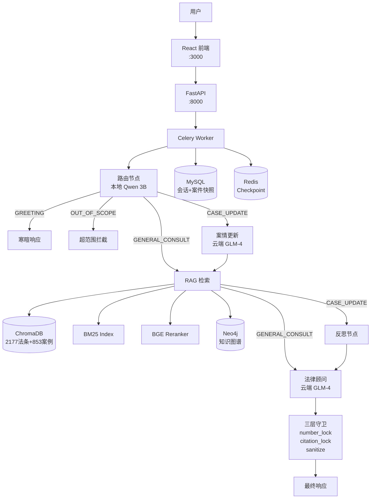

# Legal Agent V3 — 中文法律问答 RAG + Agent 系统

基于 LangGraph 多智能体架构的中文法律问答系统。采用 RAG（检索增强生成）+ 确定性计算管线 + 多模型协作的混合架构，支持多轮案情分析、法条检索、赔偿计算和知识图谱推理。

## 架构亮点

| 特性 | 实现 |
|------|------|
| 多模型协作 | 本地 Qwen2.5-3B（路由分类）+ 云端 GLM-4（法律推理），云边协同架构 |
| 类型安全 | Pydantic V2 CaseState，`ge=0` 边界约束，JSON 快照持久化 |
| 确定性计算 | `build_claim_payload()` 纯函数管线，`round(x,2)` 精度保证 |
| 幻觉防御 | 三层：Prompt 约束 → number_lock/citation_lock → 代码层 sanitize |
| RAG 检索 | ChromaDB dense + BM25 sparse 双路召回，BGE Reranker v2-m3 重排 |
| 知识图谱 | Neo4j 实时三元组提取，会话级子图，全局图谱查询 |
| 路由安全 | 四轨路由（GREETING/GENERAL_CONSULT/CASE_UPDATE/OUT_OF_SCOPE）+ 本地模型 guardrail |
| 用户数据 | MySQL 会话历史 + 案件快照（CaseState JSON）+ 案件类型自动推断 + 检索 API |
| 用户个性化图谱 | Neo4j user_id 隔离 + 跨案件共享实体发现 + 历史案件上下文注入 |
| 可解释性 | CalculationTrace 白盒契约，VERBATIM 超额纠错注入 |
| 架构瘦身 | 主编排器 1903→239 行（-87%），关注点分离到 7 个节点 |
| 测试覆盖 | 274 个确定性断言，零 LLM/IO/网络依赖 |

## 技术栈

- **后端框架**: FastAPI + Celery + Redis
- **LLM**: 本地 Qwen2.5-3B-AWQ (vLLM) + 云端 GLM-4-Flash (智谱 API)
- **向量检索**: ChromaDB (dense) + BM25 (sparse) + BGE Reranker v2-m3
- **知识图谱**: Neo4j
- **数据库**: MySQL 8.0 (用户/会话/消息/案件快照)
- **Agent 框架**: LangGraph StateGraph
- **类型系统**: Pydantic V2
- **前端**: React (端口 3000)

## 系统架构



## 项目结构

```text
app/                          # 主应用 (6769行, 45个Python文件)
├── core/
│   ├── llm_factory.py        # Surgery #12: 本地/云端双轨 LLM 工厂
│   └── ...
├── agent/
│   ├── graph.py              # LangGraph StateGraph (124行)
│   ├── tools.py              # RAG 混合检索 (372行)
│   ├── guards.py             # 三层守卫 (577行)
│   ├── nodes/
│   │   ├── _llm.py           # 双模型工厂 + 工具执行
│   │   ├── advisor.py        # 法律顾问 + Surgery #11 confidence (456行)
│   │   ├── router.py         # 四轨路由 + guardrail (466行)
│   │   ├── fact_updater.py   # 案情更新
│   │   ├── reflector.py      # 反思节点
│   │   ├── researcher.py     # 向量检索 + 图谱加载 + 用户历史案件实体
│   │   └── clarifier.py      # 澄清节点
│   └── prompts/              # Prompt 统一管理
├── schemas/
│   └── case_state.py         # CaseState Pydantic 模型 (224行)
├── logic/
│   └── calculators.py        # 确定性计算管线 (444行)
├── services/
│   ├── legal_agent.py        # 薄壳编排器 (239行, 从1903行瘦身87%)
│   ├── conversation_store.py # 会话+案件快照持久化 (288行+)
│   └── graph_extractor.py    # Surgery #14: user_id 写入 + 用户图谱查询
├── database/
│   ├── mysql_db.py           # 异步 SQLAlchemy 引擎
│   ├── chroma_mgr.py         # ChromaDB 管理
│   └── neo4j_mgr.py          # Neo4j 连接管理
├── models/
│   └── entities.py           # ORM: User/Conversation/Message
├── api/                      # FastAPI 路由
│   ├── dialog.py             # 对话接口
│   ├── conversations.py      # 会话CRUD + 案件搜索
│   ├── graph.py              # Surgery #14: 用户图谱 API
│   └── auth.py               # JWT认证
└── celery_app.py             # 任务调度 (326行)

scripts/
├── warmup.py                 # 服务预热脚本
└── backfill_graph_user_id.py # Surgery #14: 图谱 user_id 回填

docs/
├── latency_analysis.md       # 延迟分析 + Mermaid 时序图
└── confidence_score_diagnosis.md

e2e_tests/                    # 端到端测试套件
tests/                        # 单元测试 (274 passed)
```

## 快速启动

### 环境要求
- Python 3.10+
- MySQL 8.0
- Redis
- Neo4j
- (可选) vLLM + CUDA GPU

### 启动步骤
```bash
# 1. 安装依赖
pip install -r requirements.txt

# 2. 配置环境变量 (.env)
cp .env.example .env  # 编辑数据库连接、API Key 等

# 3. 启动后端
uvicorn app.main:app --host 0.0.0.0 --port 8000

# 4. 启动 Celery Worker
celery -A app.celery_app worker --loglevel=info

# 5. (可选) 启动本地 vLLM
python -m vllm.entrypoints.openai.api_server \
  --model Qwen/Qwen2.5-3B-Instruct-AWQ \
  --port 8001 --host 0.0.0.0

# 6. 预热服务
python scripts/warmup.py
```

## API 接口

| 方法 | 路径 | 说明 |
|------|------|------|
| POST | `/auth/login` | JWT 认证登录 |
| POST | `/dialog` | 提交对话请求（异步） |
| GET | `/dialog/status/{task_id}` | 轮询任务结果 |
| POST | `/conversations` | 创建新会话 |
| GET | `/conversations` | 列出用户会话 |
| GET | `/conversations/search` | 按类型/关键词搜索案件 |
| GET | `/conversations/{id}/messages` | 获取会话消息历史 |
| GET | `/conversations/{id}/graph` | 获取会话知识图谱 |
| GET | `/graph/subgraph?query=` | 全局图谱查询 |
| GET | `/graph/user/{user_id}/cases` | 用户案件图谱概览 |
| GET | `/graph/user/{user_id}/cross-case-entities` | 跨案件共享实体发现 |

## 测试

```bash
D:/Dev/python310/python.exe -m pytest tests/ -v --tb=long
```

**当前基线**: 274 passed, 0 failed

所有测试为确定性断言，零 LLM、零 IO、零网络依赖。

| 测试维度 | 覆盖 |
|----------|------|
| CaseState Pydantic 模型 | 边界值 + None 防御 + JSON 序列化 |
| 确定性计算管线 | 金额精度 + 浮点安全 |
| 幻觉守卫 | 案号豁免 + number_lock + citation_lock |
| 代码层守卫 | unverified_claims + hallucinated_statutes |
| 路由 | 四轨分类 + guardrail + OOS 拦截 |
| Confidence | 启发式四档 + reflector 不覆盖 |
| 案件类型推断 | 7类 + 空输入 |
| 案件快照 | JSON roundtrip + 序列化 |
| 用户图谱隔离 | user_id 透传 + API 路由 + 查询常量 |

## 开发历程

| Surgery | 名称 | 性质 |
|---------|------|------|
| #1 | CaseState Pydantic 强类型模型 | 架构 |
| #2 | 确定性计算管线 | 架构 |
| #3 | Prompt 统一管理 | 架构 |
| #4a/4b | legal_agent 瘦身 + 节点拆分 (1903→239行) | 架构 |
| #5 | Pydantic 全面接管 | 质量 |
| #6 | LLM 幻觉三层防护 | 安全 |
| #7 | CalculationTrace 白盒契约 | 可解释性 |
| #8 | OUT_OF_SCOPE 路由拦截 | 安全 |
| #9 | 代码层强制守卫 | 安全 |
| #10 | Bug 修复 (浮点/案号/空值/常量) | 质量 |
| #11 | Confidence 启发式补丁 | 功能完善 |
| #12/12A | 本地 Qwen 3B 路由 + guardrail | 多模型协作 |
| #13 | 案件快照持久化 + 类型推断 + 搜索 API | 用户数据 |
| #14 | Neo4j 用户个性化图谱 | 数据 |
| #Q1 | 双倍工资 cap_rule 显式化 | 回答质量 |
| #Q2 | 场景化行动清单生成器 | 回答质量 |
| #Q3/Q4 | RAG 法条引用激励 + 程序性指导解禁 | 回答质量 |

### Surgery #12/12A: 本地 vLLM 多模型协作
- 本地 Qwen2.5-3B-Instruct-AWQ 接管 `router_llm`（意图路由）
- 云端智谱 GLM-4 继续负责 `expert_llm`（法律推理）和 `summary_llm`（案情合并）
- 新增 `app/core/llm_factory.py` 统一模型工厂，支持本地/云端双轨
- 查询扩展 LLM 支持本地优先 + 云端 fallback
- 查询扩展双轨调用已改为短路模式：本地扩展在 5 秒内返回有效 JSON 时直接采用，只有超时/异常/无效结果才回落云端
- 新增 `Query expansion path: local / cloud_fallback` 日志打点，便于定位检索链路延迟来源
- Router guardrail：本地小模型路由结果校验

### Surgery #13: MySQL 用户数据层补全
- `conversations` 表新增 `case_state_json`（CaseState Pydantic 序列化）和 `case_type`（自动推断）
- 持久化结构化案件快照，支持跨会话恢复
- 新增案件搜索 API: `GET /conversations/search?case_type=&keyword=`
- 多轮场景下 `saved_case_state` fallback 已接入 advisor 节点

### Surgery #14: Neo4j 用户个性化图谱
- 所有 `DynamicCaseEntity` 节点和 `CASE_RELATION` 关系写入时携带 `user_id`
- 新增用户案件图谱概览 API: `GET /graph/user/{user_id}/cases`
- 新增跨案件共享实体发现 API: `GET /graph/user/{user_id}/cross-case-entities`
- `researcher` 节点增强：自动加载用户历史案件实体到图谱上下文
- 回填脚本: `scripts/backfill_graph_user_id.py`
- 静态知识图谱（Law/Case/Party）保持全局共享不变

### Surgery Q-1 ~ Q-4: 回答质量增强
- Q-1：在 `build_claim_payload()` 的 answer 文本中显式注入二倍工资计算规则，补充“首月不计入 / 11 个月上限 / 次月起算”。
- Q-2：新增 `_build_action_checklist()`，按劳动争议、借贷、离婚、刑事等场景生成证据清单、流程步骤、时效与风险提示。
- Q-3：advisor prompt 明确鼓励在 `<rag_context>` 存在条文编号时主动引用真实法条，提高法条真实性与专业感。
- Q-4：advisor prompt 解禁程序性指导，允许保留并润色证据清单、流程说明、费用/管辖/时效等操作性内容。

## 端到端基准测试

| 指标 | 值 |
|------|-----|
| Fix 2 多轮月薪连贯专项 | 100% (8/8) |
| 全面质量基准总分 | 55/80 (68%) |
| D1 金额计算 | 46% |
| D2 法条真实性 | 60% |
| D3 多轮案情连贯性 | 90% |
| D4 回答完整性 | 75% |
| D5 回答可操作性 | 72% |
| D6 幻觉抑制 | 72% |
| D7 案例引用质量 | 80% |
| D8 系统健康 | 60% |
| 单元测试 | 274 passed, 0 failed |

> 详细数据见 `e2e_tests/results/e2e_fix_validation.json` 与 `e2e_tests/results/quality_benchmark_report.json`

## 研究与工程成果

- 从单体式 `legal_agent.py` 演进到 LangGraph 节点化编排，完成职责解耦与代码瘦身。
- 将“计算”与“生成”彻底分层：金额、月数、赔偿总额均由纯 Python 管线白盒产出。
- 建立 Prompt 守卫 + 后处理守卫 + 结构化快照持久化三层质量闭环。
- 引入本地 3B 路由模型承担低成本分类任务，云端模型集中用于高质量法律推理。
- 将用户会话从纯文本历史升级为“消息 + 摘要 + CaseState JSON 快照 + 案件类型标签”的持久化数据层。
- 建立 Neo4j 用户级动态图谱隔离，并支持跨案件共享实体发现与历史案件实体上下文注入。

## 演示建议

- 优先展示四类输入：寒暄、普通法律咨询、案件更新、超范围问题。
- 劳动争议样例最适合展示完整链路：事实抽取 → CaseState → 赔偿计算 → 案件快照。
- 可以配合 `/conversations/search?case_type=劳动争议` 演示用户历史案件检索。
- 若需要答辩展示，可同时打开 Neo4j Browser、MySQL 会话表和接口返回结果。

## 已知运行注意事项

- 本地开发建议先启动 Redis、MySQL、Neo4j，再启动 FastAPI 与 Celery Worker。
- Windows 环境下 Celery/模型加载容易受编码与显存环境影响，建议先执行预热脚本。
- 端到端验证脚本位于 `e2e_tests/`，适合在服务全部启动后单独执行。
- 图谱相关调试可直接访问 `/graph/user/{user_id}/cases` 与 `/graph/user/{user_id}/cross-case-entities`。

## 许可证与说明

- 本项目面向中文法律智能问答研究与工程实践展示。
- README 中的测试基线与质量指标已同步至 Surgery Q1~Q4 完成状态。
