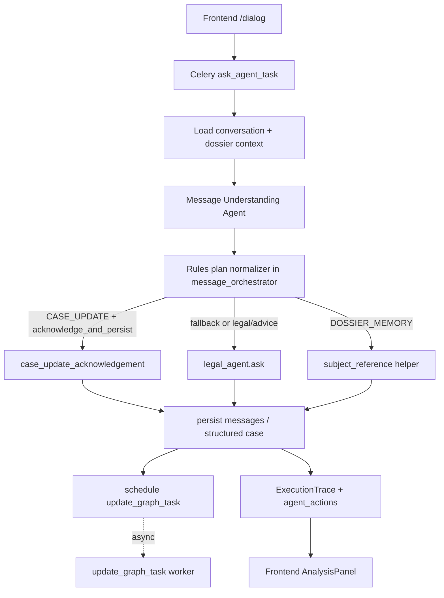
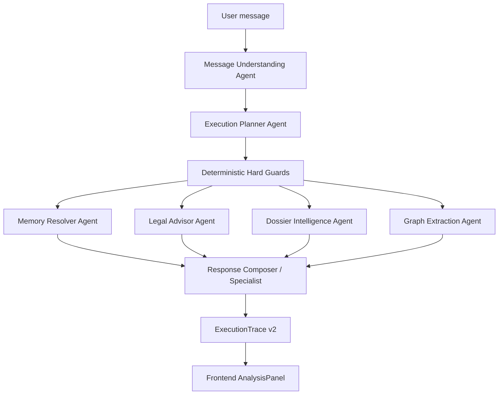

# Agent Orchestration Architecture Audit

## 1. Current Runtime Flow

当前一次 `/dialog` 请求的真实运行主链路，不是单一 agent，也不是单一规则链，而是一个混合编排：

1. 前端 `frontend/src/App.vue` 调用 `/dialog`。
2. 后端 API 提交 Celery `ask_agent_task`。
3. `app/celery_app.py` 先同步读取会话上下文：
   - recent messages
   - conversation `case_summary` / `case_state_json`
   - current conversation graph memory
   - dossier context / dossier graph context
4. `ask_agent_task` 调用 `understand_message_with_agent(...)`。
5. `build_execution_plan_from_message_understanding(...)` 把 MU 结果归一成 execution plan。
6. `ask_agent_task` 按 plan 执行三类主分支：
   - `subject_reference` -> `_answer_subject_reference_message_async(...)`
   - `fact_update` / `confirm_previous_fact` -> 轻量 acknowledgement specialist，外加 persistence / graph scheduling
   - 其他情况 -> 回落到 `legal_agent.ask(...)`
7. 回答生成后，`ask_agent_task` 决定：
   - 是否写 `messages`
   - 是否写 conversation structured case
   - 是否调度 `update_graph_task.delay(...)`
8. `ExecutionTrace` 产出结构化 trace；`agent_actions` 继续保留兼容。
9. 前端 `AnalysisPanel` 优先显示 `execution_trace`，缺失时再猜测旧 `agent_actions`。

同步与异步边界：

- 同步：
  - `/dialog` 到 Celery `ask_agent_task` 的主执行
  - MU 调用
  - execution plan 构建
  - `subject_reference` helper
  - `case_update_acknowledgement`
  - `legal_agent.ask(...)`
  - message persistence
- 异步：
  - `update_graph_task.delay(...)`
  - 图谱更新真正执行在独立 Celery 任务中

当前 trace 事实：

- `update_graph_task` 目前只在 `execution_trace.steps` 中记录 `scheduled` 这一刻，不记录异步任务完成/失败结果。
- `agent_actions` 仍是兼容层。
- `execution_trace` 是新权威层，但还不是全系统统一 contract。



## 2. Current Memory Layers

### recent conversation messages

- 数据来源：`messages` 表。
- 存储位置：MySQL `messages`。
- 主要文件/API：`app/services/conversation_store.py` `list_recent_conversation_messages(...)`。
- per-conversation：是。
- per-dossier：否。
- 是否持久化：是。
- 是否会被 temporary guard 阻断：否，消息本身仍保留。
- 是否进入 execution_trace：间接进入，trace 不直接记录消息内容层。
- 当前问题/盲点：
  - 是很多 agent 的事实来源，但没有统一 memory scope contract。
  - `confirm_previous_fact` 仍靠最近消息回溯，不是独立 resolver。

### conversation structured case summary / case_state_json

- 数据来源：事实型消息、legacy advisor/fact update 路径。
- 存储位置：MySQL `conversations.case_summary` / `case_state_json` / `case_type`。
- 主要文件/API：`app/celery_app.py`，`conversation_store.py`，`case_followup.py`。
- per-conversation：是。
- per-dossier：否。
- 是否持久化：是。
- 是否会被 temporary guard 阻断：是。
- 是否进入 execution_trace：部分进入，作为 `fact_persistence` step；不会完整暴露内容。
- 当前问题/盲点：
  - 仍受 `case_followup` 规则控制。
  - `temporary` 时目前会阻断持久化，但分析路径设计仍未完全与 planner contract 对齐。

### conversation raw graph

- 数据来源：用户事实文本经 `graph_extractor` 抽取。
- 存储位置：Neo4j `DynamicCaseEntity` / `CASE_RELATION`。
- 主要文件/API：`graph_extractor.py`，`update_graph_task`，`format_graph_memory(...)`。
- per-conversation：是。
- per-dossier：否。
- 是否持久化：是。
- 是否会被 temporary guard 阻断：是。
- 是否进入 execution_trace：只记录 graph update scheduling，不记录图谱完成状态。
- 当前问题/盲点：
  - 图谱是主 memory layer 之一，但 async completion 不可见。
  - raw graph 与 dossier overlay 的边界只能靠约定，不靠统一 contract。

### dossier raw graph aggregation

- 数据来源：多个 conversation raw graph 聚合。
- 存储位置：运行时从 Neo4j 查询后拼装 payload。
- 主要文件/API：`app/services/dossier_graph.py`。
- per-conversation：否。
- per-dossier：是。
- 是否持久化：原始数据持久化在 Neo4j；聚合 payload 本身不持久化。
- 是否会被 temporary guard 阻断：间接会，因为 temporary 阻断写 conversation graph。
- 是否进入 execution_trace：不直接进入。
- 当前问题/盲点：
  - 是 dossier intelligence 和 memory query 的基础，但主链路没有显式 scope 选择记录。

### dossier participant overlay

- 数据来源：用户确认的 dossier participants、mentions、resolution decisions。
- 存储位置：MySQL `dossier_participants` / `dossier_participant_mentions` / `dossier_entity_resolution_decisions`。
- 主要文件/API：`conversation_store.py`，`api/dossiers.py`。
- per-conversation：mentions 是；participant/decision 以 dossier 为主。
- per-dossier：是。
- 是否持久化：是。
- 是否会被 temporary guard 阻断：通常不直接相关；temporary 主要阻断新事实进入图谱。
- 是否进入 execution_trace：不会进入 `/dialog` 的主 trace；在 dossier intelligence trace 中以任务结果体现。
- 当前问题/盲点：
  - overlay 很关键，但用户主链路没有统一记录“读了哪个 overlay scope”。

### dossier display graph

- 数据来源：raw graph + participant mappings overlay。
- 存储位置：运行时构建，不直接写回 Neo4j。
- 主要文件/API：`app/services/dossier_display_graph.py`。
- per-conversation：否。
- per-dossier：是。
- 是否持久化：否，属于派生视图。
- 是否会被 temporary guard 阻断：间接影响其原料，但不是直接 guard 目标。
- 是否进入 execution_trace：不会进入 `/dialog` 主 trace。
- 当前问题/盲点：
  - display graph 是给 intelligence 和 UI 的高层视图，但主对话没有显式 memory scope 标记。

### dossier coordination graph

- 数据来源：raw graph / display graph / participant overlay / resolution decisions。
- 存储位置：运行时构建。
- 主要文件/API：`app/services/dossier_coordination_graph.py`。
- per-conversation：否。
- per-dossier：是。
- 是否持久化：否。
- 是否会被 temporary guard 阻断：间接影响。
- 是否进入 execution_trace：不进入 `/dialog` 主 trace。
- 当前问题/盲点：
  - 本质上还是规则驱动的“任务整理器”，不是 agent contract。

### dossier intelligence summary/tasks

- 数据来源：
  - dossier summary 字段
  - raw graph
  - display graph
  - participant candidates
  - resolution decisions
- 存储位置：运行时返回 JSON，不写 DB。
- 主要文件/API：`app/services/dossier_intelligence.py`，`GET /dossiers/{id}/intelligence`。
- per-conversation：可带 conversation_id 视角，但核心是 dossier 级。
- per-dossier：是。
- 是否持久化：否。
- 是否会被 temporary guard 阻断：不是直接阻断对象。
- 是否进入 execution_trace：不进入 `/dialog` 主 trace；有自己的 `trace.steps`。
- 当前问题/盲点：
  - classifier 已接入，但仍混有自锚点规则任务。
  - 与主 orchestrator trace 仍是两套契约。

### legal RAG knowledge base

- 数据来源：Chroma / BM25 / Neo4j law references。
- 存储位置：向量库 + law graph。
- 主要文件/API：`app/agent/tools.py`，`advisor.py`，`researcher.py`。
- per-conversation：否。
- per-dossier：否。
- 是否持久化：是。
- 是否会被 temporary guard 阻断：不阻断；temporary 不等于禁止法律分析。
- 是否进入 execution_trace：旧 legal path 只粗粒度记录 `legal_agent_answer`，不会展开 query expansion / retrieval 细步。
- 当前问题/盲点：
  - 仍是 legal path 的主知识层，但 planner 没有统一声明 `legal_rag` scope。

## 3. Current Module Inventory

| Module | File(s) | Current Role | Current Driver | Input | Output | Writes DB? | Writes Neo4j? | Appears in execution_trace? | Should remain rule? | Should become agent? | Known Issues |
|---|---|---|---|---|---|---|---|---|---|---|---|
| Message Understanding Agent | `app/services/message_understanding_agent.py` | 结构化理解 intent / route / subject_reference / fact update | LLM/API Agent + fallback rules | current message, recent messages, dossier context | structured MU JSON | No | No | Yes | No | Yes, already is | 实际已驱动主链路，但函数名/历史 shadow 残留造成误导 |
| ExecutionTrace | `app/services/execution_trace.py` | 收集结构化执行轨迹 | Rules | orchestrator step events | trace payload | No | No | self | Yes | No | 只覆盖 `/dialog` 主链路；异步 graph completion 不可见 |
| ask_agent_task orchestrator | `app/celery_app.py` | 当前主编排器 | Hybrid | MU result, conversation context, dossier context | answer + persistence + scheduling | Yes | Schedules write | Yes | Partly | Planner/dispatcher 应 agent 化 | 仍有较多路由/guard/持久化判断挤在一个函数里 |
| legacy router | `app/agent/nodes/router.py` | 旧四路路由和检索工具决策 | Hybrid, rule-heavy | question, chat history | route_intent, tool calls | No | No | No | Fallback only | No | 仍主导 legal_agent 主路径，且包含大量启发式关键词 |
| case_followup | `app/services/case_followup.py` | 事实补充/追问/persistence 规则 | Rules | message text, mode, consent | bool / summary merge | No | No | Indirect via guards | Yes for guards only | intent 部分应退出 | 仍承担事实识别，和 MU 责任重叠 |
| legal_agent | `app/services/legal_agent.py` | legacy LangGraph 入口 | Hybrid | question, case summary, graph memory, dossier context | legal answer dict | No | No | Only wrapped as one step | No | Legal advisor should remain agent; orchestration should move out | 内部节点很多，但对外只暴露单步黑盒 |
| advisor | `app/agent/nodes/advisor.py` | grounded legal answer generation | Hybrid | retrieved law/case context + state | final answer | No | No | No | citation guards yes | Yes, as specialist | 对主 trace 不透明 |
| fact_updater | `app/agent/nodes/fact_updater.py` | legacy CASE_UPDATE summary merge | Rules/Hybrid | question, state | updated case summary/state | No | No | No | No | 应降为 fallback | H7 主链路已绕开，但 legacy path 仍在 |
| graph_extractor | `app/services/graph_extractor.py` | conversation raw graph extraction | LLM/API Agent + schema guard | factual text, existing graph | normalized graph actions | No | Yes | Only scheduling step visible | schema guard yes | Yes, already is | 完成结果未进入 main trace |
| update_graph_task | `app/celery_app.py` | async graph refresh worker | Hybrid | conversation_id, user_id, message_id | graph refresh result | Reads DB | Yes | Scheduled only | No | should expose callback trace | 主链路看不到异步完成 |
| dossier_graph_tool | `app/services/dossier_graph_tool.py` | dossier graph query classification + context building | Rule-heavy Hybrid | question, dossier scope, mode | query kind, dossier graph context | No | No | Indirect only | hard guards yes | memory scope selection should move to agent | 关键词式 memory/advice/legal 分类仍重 |
| dossier_display_graph | `app/services/dossier_display_graph.py` | overlay-confirmed participant view | Rules | raw graph + mappings | display graph | No | No | No | Yes | No | 视图边界清晰，应保持 deterministic |
| dossier_coordination_graph | `app/services/dossier_coordination_graph.py` | 构造 pending tasks / responsible view | Rules | raw/display graph + decisions | coordination graph payload | No | No | No | 部分 | task classification should move to agent | 规则整理过重，容易误把关系任务变 identity |
| dossier_intelligence | `app/services/dossier_intelligence.py` | dossier summary + confirmation tasks + candidate classifier | Hybrid | raw/display graph, candidates, decisions | intelligence payload | No | No | Own trace only | summary fallback yes | classifier/summary should be agents | self-anchor 规则和 classifier 并存 |
| participant candidate builder | `app/services/conversation_store.py` | unresolved graph node -> candidate/evidence builder | Hybrid, rule-heavy | graph payload, mentions, participants, decisions | candidate list | No | No | No | evidence builder yes | final classification should not stay here | 仍决定部分 task_type 和 cross-conversation pairing |
| AnalysisPanel | `frontend/src/components/AnalysisPanel.vue` | render trace and compatibility status | UI | execution_trace, agent_actions | user-visible timeline | No | No | consumes | Yes | No | 当前仍包含兼容猜测和部分展示乱码/映射债务 |

## 4. Hard Rules That Must Remain Deterministic

以下逻辑必须继续是 deterministic，不应交给 LLM：

- auth / owner checks
  - 原因：权限边界不能依赖概率输出。
- temporary blocks persistence and graph writes
  - 原因：这是用户 consent 边界，不是语义判断。
- LEGAL_QA blocks case graph pollution
  - 原因：防止法律问答污染案情图谱，属于安全边界。
- schema validation
  - 原因：所有 agent JSON 都必须可验证、可回退。
- database constraints
  - 原因：唯一性、外键、字段合法性必须由 DB 与规则保证。
- provider fallback / timeout handling
  - 原因：当 agent 不可用时，系统必须可预测降级。
- hallucination guard / fabricated citation stripping
  - 原因：法条与案例引用不能交给生成模型自证正确。
- exact law article lookup when user explicitly asks a statute
  - 原因：显式法条定位需要精确命中，不适合模糊生成。
- no raw graph mutation from dossier overlay
  - 原因：display/overlay 是派生层，不能反写 raw graph。
- no cross-user / cross-dossier automatic merge
  - 原因：用户数据隔离和主体误合并风险太高。
- frontend label/status localization
  - 原因：展示映射是确定性 UI 责任，不是语义推理。

## 5. Logic That Should Move To API Agents

### message intent routing remnants

- 当前由哪里处理：`router.py`、`case_followup.py`、`dossier_graph_tool.py`。
- 为什么规则不合适：问法一变就会分流漂移，且会与 MU 结论冲突。
- 目标 agent：Message Understanding Agent。
- 目标结构化输出：`intent` / `route_hint` / `needs_*` / `mixed_intents[]`。

### execution response_mode planning

- 当前由哪里处理：`message_orchestrator.py`。
- 为什么规则不合适：temporary、fact update、confirm previous fact、mixed question 会越来越复杂。
- 目标 agent：Execution Planner Agent。
- 目标结构化输出：`primary_route` / `response_mode` / `agent_steps[]` / `writes` / `guards_requested`。

### subject reference scope planning

- 当前由哪里处理：MU 输出部分 schema，实际 scope 选择在 `celery_app.py` helper 内。
- 为什么规则不合适：当前会话、当前消息、confirmed participants、display graph、cross-conversation candidates 的优先级需要语义选择。
- 目标 agent：Memory Resolver Agent。
- 目标结构化输出：`scope_order` / `selected_scope` / `ambiguity` / `answer_mode`。

### memory scope selection

- 当前由哪里处理：`dossier_graph_tool.py` 关键词规则 + orchestrator helper。
- 为什么规则不合适：同一句话可能既要法律分析也要案卷记忆。
- 目标 agent：Execution Planner Agent + Memory Resolver Agent。
- 目标结构化输出：`memory_scopes[]` / `legal_scopes[]` / `scope_priority[]`。

### dossier confirmation task classification

- 当前由哪里处理：`conversation_store.py` 规则分桶 + `dossier_intelligence.py` classifier 混合。
- 为什么规则不合适：identity / party_naming / affiliation_relation / not_actionable 很依赖上下文语义。
- 目标 agent：Dossier Intelligence Agent。
- 目标结构化输出：`confirmation_tasks[]` with `task_type`, `subject_kind`, `confidence`, `requires_user_confirmation`, `reason`。

### temporary case analysis answer planning

- 当前由哪里处理：planner 规则。
- 为什么规则不合适：temporary 不是“只回 acknowledgement”，而是“禁止持久化，但允许分析”。
- 目标 agent：Execution Planner Agent。
- 目标结构化输出：`response_mode=case_analysis_without_persistence`, `needs_legal_rag=true`, `writes.*=false`。

### mixed question planning

- 当前由哪里处理：基本没有统一层，更多靠 legacy legal path 吞掉。
- 为什么规则不合适：同一轮可能含事实补充 + 法律问题 + 指代问题。
- 目标 agent：Execution Planner Agent。
- 目标结构化输出：`sub_intents[]` / `step_order[]` / `response_composition_strategy`。

### dossier intelligence summary / timeline / key facts

- 当前由哪里处理：`dossier_intelligence.py` 规则 + dossier summary 字段。
- 为什么规则不合适：需要在多会话、多主体、多证据下形成语义摘要。
- 目标 agent：Dossier Intelligence Agent。
- 目标结构化输出：`summary`, `timeline`, `key_facts`, `warnings`。

### graph quality warnings

- 当前由哪里处理：零散 warnings、display notes、coordination graph rules。
- 为什么规则不合适：冲突事实、歧义主体、弱映射证据更适合 agent 汇总。
- 目标 agent：Graph Extraction Agent 或 Dossier Intelligence Agent。
- 目标结构化输出：`graph_quality_warnings[]`。

### response style selection

- 当前由哪里处理：advisor prompt、case_update_acknowledgement 规则模板。
- 为什么规则不合适：不同 route 需要不同 verbosity、tone、evidence density。
- 目标 agent：Response Composer / Specialist。
- 目标结构化输出：`response_style`, `max_sentences`, `include_legal_basis`, `include_next_steps`。

## 6. Target Agent Architecture

目标架构应把“语义判断”和“写入 enforcement”分开：

1. Message Understanding Agent
2. Execution Planner Agent
3. Memory Resolver Agent
4. Legal Advisor Agent
5. Dossier Intelligence Agent
6. Response Composer / Specialist
7. Graph Extraction Agent

核心原则：

- 所有 agent 决策输出必须是结构化 JSON。
- hard guards 在 planner 之后做 deterministic enforcement。
- 所有 agent step 都必须进入 `execution_trace`。
- fallback 必须显式标记 `provider` / `model` / `fallback_reason`。
- legacy router 只能作为 fallback，不应主导核心理解。



## 7. Execution Contract v2 Proposal

建议统一成以下 contract：

```json
{
  "schema_version": "2",
  "request_id": "req-123",
  "conversation_scope": {
    "conversation_id": 1,
    "dossier_id": 2,
    "conversation_mode": "TRACKED_CASE",
    "persistence_consent": "tracked"
  },
  "message_understanding": {
    "intent": "subject_reference",
    "route_hint": "DOSSIER_MEMORY",
    "provider": "openai",
    "model": "gpt-5.1",
    "fallback_used": false,
    "fallback_reason": null
  },
  "execution_plan": {
    "route": "DOSSIER_MEMORY",
    "response_mode": "dossier_memory_answer",
    "memory_scopes": [
      "current_conversation_graph",
      "current_conversation_messages",
      "dossier_confirmed_participants",
      "dossier_display_graph",
      "dossier_cross_conversation_candidates"
    ],
    "agent_steps": [
      "memory_resolution",
      "response_composer"
    ],
    "persistence_allowed": false,
    "graph_update_allowed": false,
    "requires_clarification": false,
    "reason": "Current message asks for subject reference."
  },
  "memory_resolution": {
    "scope_order": [
      "current_conversation_graph",
      "current_conversation_messages",
      "dossier_confirmed_participants",
      "dossier_display_graph",
      "dossier_cross_conversation_candidates"
    ],
    "selected_scope": "current_conversation_graph",
    "candidate_count_by_scope": {
      "current_conversation_graph": 1
    },
    "used_evidence": [
      "B公司",
      "劳动合同",
      "社保争议"
    ]
  },
  "steps": [
    {
      "name": "message_understanding",
      "agent": "message_understanding_agent",
      "driver": "llm",
      "provider": "openai",
      "model": "gpt-5.1",
      "status": "success",
      "input_summary": "subject reference query",
      "output_summary": "subject_reference -> DOSSIER_MEMORY",
      "fallback_reason": null,
      "duration_ms": 123
    }
  ],
  "guards_applied": [
    {
      "name": "temporary_blocks_persistence",
      "triggered": false
    }
  ],
  "writes": {
    "messages": true,
    "structured_case": false,
    "graph_update_scheduled": false,
    "dossier_overlay": false
  },
  "legacy_fallback": {
    "used": false,
    "reason": null
  }
}
```

这个 contract 要解决三类典型问题：

- “这里的公司”应先查当前会话，再查案卷：
  - 通过 `memory_scopes` 和 `memory_resolution.selected_scope` 明确记录，不再让 helper 暗猜。
- `temporary` 只阻断持久化但仍给法律分析：
  - 通过 `response_mode=case_analysis_without_persistence`
  - 同时 `persistence_allowed=false`，`graph_update_allowed=false`
  - legal path 仍可执行。
- `B公司/公司` 不应变成 `party_naming`：
  - 通过 Dossier Intelligence Agent 输出 `entity_identity` 或 `not_actionable`
  - 不再让前端或 rules builder 把 generic org 当 self anchor。
- 前端 AnalysisPanel 不再猜状态：
  - 直接消费 `steps[]`, `guards_applied[]`, `legacy_fallback`。

## 8. Memory Scope Contract

### current_conversation_messages

- when to use：上一轮事实确认、对话省略补全。
- who selects it：Memory Resolver Agent。
- expected payload：`[{role, content, message_id, created_at}]`
- whether legal basis：否。
- whether fact memory：是。
- priority rules：在 subject reference 中排在 conversation graph 之后。
- fallback behavior：无可用消息时返回空列表。

### current_conversation_structured_case

- when to use：摘要式案情补全、事实归纳。
- who selects it：Execution Planner / Memory Resolver。
- expected payload：`case_summary`, `case_state_json`, `case_type`
- whether legal basis：否。
- whether fact memory：是。
- priority rules：比 dossier scopes 更高，但低于 current conversation raw graph 对实体解析的权重。
- fallback behavior：缺失则不阻断其他 scopes。

### current_conversation_graph

- when to use：当前会话主体、事件、关系查询。
- who selects it：Memory Resolver Agent。
- expected payload：raw graph nodes/edges or summarized graph memory。
- whether legal basis：否。
- whether fact memory：是。
- priority rules：subject reference 第一优先。
- fallback behavior：空图则继续 messages。

### dossier_confirmed_participants

- when to use：已确认主体名称、party naming、confirmed identity。
- who selects it：Memory Resolver / Dossier Intelligence。
- expected payload：confirmed participants + mentions。
- whether legal basis：否。
- whether fact memory：是，且偏高可信度。
- priority rules：在 current conversation scopes 之后，在 display graph 之前。
- fallback behavior：没有 confirmed participant 就跳过。

### dossier_display_graph

- when to use：跨会话主体聚合后的高层视图。
- who selects it：Memory Resolver / Dossier Intelligence。
- expected payload：display nodes, remapped edges, stats。
- whether legal basis：否。
- whether fact memory：是。
- priority rules：confirmed participants 后、cross-conversation candidates 前。
- fallback behavior：构建失败时降到 raw candidates。

### dossier_coordination_graph

- when to use：展示待确认任务、责任主体网络。
- who selects it：Dossier Intelligence。
- expected payload：pending tasks, responsible entities, evidence edges。
- whether legal basis：否。
- whether fact memory：是，但更偏 workflow memory。
- priority rules：不应用于直接做 subject reference 主证据。
- fallback behavior：失败时不阻断基本 display/intelligence。

### dossier_cross_conversation_candidates

- when to use：只有在前几层都不能确认时，用于提示“可能是 B 公司，需要确认”。
- who selects it：Memory Resolver Agent。
- expected payload：candidate pairs + prior decisions。
- whether legal basis：否。
- whether fact memory：是，但置信度最低。
- priority rules：subject reference 最后一级。
- fallback behavior：若仍歧义，返回 clarification。

### legal_rag

- when to use：法律问答、法律分析、建议路径。
- who selects it：Execution Planner / Legal Advisor。
- expected payload：law articles, case snippets, retrieval metadata。
- whether legal basis：是。
- whether fact memory：否。
- priority rules：仅 legal/advice route；subject_reference 不得直接调用。
- fallback behavior：provider/retrieval 失败时显式 fallback，不得伪造法条。

subject_reference 推荐 scope_order：

1. `current_conversation_graph`
2. `current_conversation_messages`
3. `dossier_confirmed_participants`
4. `dossier_display_graph`
5. `dossier_cross_conversation_candidates`

## 9. Benchmark and Regression Strategy

不要再把 legacy quality 当成日常回归入口。

### A. 小改动

- `pytest` targeted
- 受影响模块测试
- 如果改前端，跑 `npm run build`

### B. agent / orchestration 改动

- `tests/test_h7_*.py`
- 相关 `H6c` / `H4f` / `H2c` 测试
- smoke benchmark
- 如果动 legal path，再跑 `legal_qa_benchmark.py`
- 如果动 workspace path，再跑 workspace targeted suite

### C. graph / dossier 改动

- `H6c` tests
- `workspace_participant` / `workspace_memory`
- personalized workspace targeted benchmark

### D. release / milestone

- `pytest` full
- `run_benchmarks.py --profile full --check-readiness`
- legacy quality 仅在明确要求时低频运行

当前项目已有正确方向：

- `e2e_tests/BENCHMARK_STRATEGY.md` 已明确：
  - smoke
  - legal_qa
  - workspace suites
  - legacy 低频手动

因此建议沿用这一策略，而不是倒退回单体 benchmark。

## 10. Migration Plan

### H7-7 Execution Planner Agent

- goal：把 `message_orchestrator.py` 从规则 normalizer 升级为真正 planner agent。
- files likely touched：
  - `app/services/message_orchestrator.py`
  - `app/celery_app.py`
  - `app/services/execution_trace.py`
- tests：
  - `tests/test_h7_message_orchestration_plan.py`
  - `tests/test_h7_paraphrase_matrix.py`
- manual validation：
  - fact update
  - temporary fact update
  - mixed legal + fact messages
- risk：
  - plan schema 变化会影响 trace 和前端。

### H7-8 Memory Resolver Agent

- goal：把 subject reference 和 memory scope selection 从 helper/rules 抽离。
- files likely touched：
  - `app/celery_app.py`
  - new `app/services/memory_resolver_agent.py`
  - `app/services/message_understanding_agent.py`
- tests：
  - `tests/test_h7_subject_reference_routing.py`
  - new scope tests
- manual validation：
  - 当前会话已知主体
  - dossier only 主体
  - 歧义澄清
- risk：
  - 过度依赖 dossier candidate 会引入误认。

### H7-9 Dossier Intelligence Task Classifier

- goal：彻底让 confirmation task 最终判定权归 dossier intelligence。
- files likely touched：
  - `app/services/dossier_intelligence.py`
  - `app/services/conversation_store.py`
  - `app/services/dossier_coordination_graph.py`
- tests：
  - `tests/test_h7_intelligence_classifier.py`
  - `tests/test_h6c_dossier_intelligence.py`
- manual validation：
  - self anchor
  - organization identity
  - role affiliation
- risk：
  - 旧规则任务与新 classifier 输出去重复杂。

### H7-10 Trace v2

- goal：让 `execution_trace` 成为完整执行 contract。
- files likely touched：
  - `app/services/execution_trace.py`
  - `app/celery_app.py`
  - `frontend/src/components/AnalysisPanel.vue`
- tests：
  - `tests/test_h7_execution_trace.py`
  - docs contract test
- manual validation：
  - fallback
  - async graph schedule
  - planner / resolver / advisor 多步链路
- risk：
  - 旧 `agent_actions` 兼容期需要保留。

### H7-11 Graph Update Trace Callback

- goal：让 async `update_graph_task` 完成状态回写 trace 或 message metadata。
- files likely touched：
  - `app/celery_app.py`
  - graph worker callback / metadata merge helper
- tests：
  - graph scheduling + completion tests
- manual validation：
  - graph success
  - graph failure
- risk：
  - async consistency 和 metadata merge 冲突。

### H8 Dossier Intelligence API Agent

- goal：把 dossier intelligence summary/timeline/warnings 完整 agent 化。
- files likely touched：
  - `app/services/dossier_intelligence.py`
  - `app/api/dossiers.py`
- tests：
  - `tests/test_h6c_dossier_intelligence*.py`
- manual validation：
  - dossier summary
  - pending tasks
  - graph quality warnings
- risk：
  - dossier UI 依赖现有 schema，兼容期较长。

## 11. Immediate Manual Test Failures Mapping

### 1. AnalysisPanel `???` 中文混乱

- 对应组件：`frontend/src/components/AnalysisPanel.vue`
- 根因类型：frontend trace rendering / localization debt
- 不应修法：不该通过后端改名来迁就 UI；应由前端确定性映射修复

### 2. `B公司/公司` 被判成 `party_naming`

- 对应组件：`dossier_intelligence` classifier 与 self-anchor rule 混用
- 根因类型：Dossier Intelligence task classifier 仍不完全掌握最终判定权
- 不应修法：不该加 `B公司` blacklist；应让 classifier 输出 `entity_identity` 或 `not_actionable`

### 3. “这里的公司”不能优先当前会话解析

- 对应组件：subject reference helper 缺少正式 Memory Resolver contract
- 根因类型：scope selection 仍分散在 MU schema、helper 和 dossier graph rules 中
- 不应修法：不该再加“这里/刚才/前面”关键词补丁；应让 resolver 显式处理 `scope_order`

### 4. `temporary` 只 acknowledgement 不法律分析

- 对应组件：Execution Planner response_mode 设计不完整
- 根因类型：temporary 被错误等同为“不要持久化 + 只返回确认”
- 不应修法：不该写 `if temporary then ack`；应让 planner 产出 `case_analysis_without_persistence`

