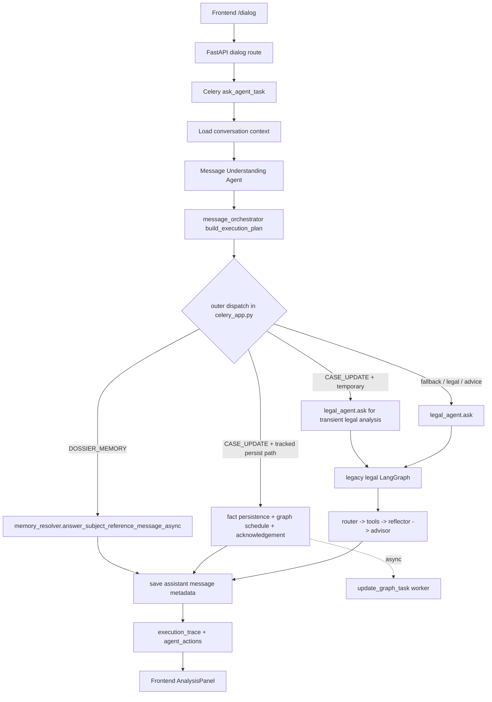
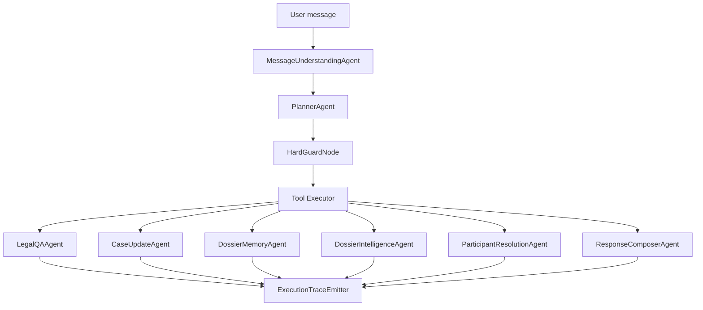

# H8 Agentic Orchestration Audit

## 1. Executive Summary

`Legal_Agent_V3` already has meaningful capabilities:

- legal RAG
- exact article lookup
- case follow-up and structured persistence
- conversation graph extraction and async graph update
- dossier graph / display graph / coordination graph
- dossier intelligence and participant resolution
- execution trace v1

The current problem is not capability coverage. The problem is control ownership.

Today the system still has two different orchestration centers:

1. [app/celery_app.py](C:/Users/123/Legal_Agent_V3/app/celery_app.py)
   - reads conversation context
   - calls message understanding
   - builds an execution plan
   - decides which branch actually runs

2. [app/services/legal_agent.py](C:/Users/123/Legal_Agent_V3/app/services/legal_agent.py) + [app/agent/nodes/router.py](C:/Users/123/Legal_Agent_V3/app/agent/nodes/router.py)
   - still owns the inner legal LangGraph
   - still performs rule-heavy routing and tool selection

That split creates the current maintenance pain:

- semantic routing is partially in `message_understanding_agent.py`
- partially in `message_orchestrator.py`
- partially in `celery_app.py`
- partially in `router.py`
- partially in `case_followup.py`
- partially in `dossier_graph_tool.py`
- partially in `conversation_store.py`

The result is a rule-dominated workflow with LLM islands, not an agentic system with deterministic safety boundaries.

The recommended target is:

`Agent Planner -> Tool Registry -> Tool Executor -> Specialist Agents -> Hard Guards -> Execution Trace`

The recommended first implementation slice is not a planner rewrite. It is a `Tool Registry skeleton`, because the current system does not yet have stable tool contracts for planner-driven execution.

## 2. Current Runtime Flow

### 2.1 Real `/dialog` Runtime Chain



### 2.2 Sync vs Async

Synchronous in the current main path:

- `understand_message_with_agent(...)`
- `build_execution_plan_from_message_understanding(...)`
- `answer_subject_reference_message_async(...)`
- `legal_agent.ask(...)`
- `build_case_update_acknowledgement(...)`

Asynchronous:

- `update_graph_task.delay(...)`

Important current limitation:

- `execution_trace` only records that graph update was scheduled.
- It does not currently record the asynchronous completion result of `update_graph_task`.

### 2.3 Current Ownership of Key Decisions

| Decision | Current Primary Owner |
|---|---|
| intent understanding | `message_understanding_agent.py` |
| execution response mode | `message_orchestrator.py` |
| actual branch dispatch | `celery_app.py` |
| legal graph internal routing | `router.py` |
| exact law lookup ordering | `app/agent/tools.py` |
| dossier graph context gating | `dossier_graph_tool.py` |
| participant candidate typing | `conversation_store.py` |
| dossier confirmation task classification | `conversation_store.py` + `dossier_intelligence.py` hybrid |
| execution trace assembly | `execution_trace.py` invoked by `celery_app.py` |
| front-end status rendering | `AnalysisPanel.vue` |

## 3. Rule-Dominated Decision Points

The following modules still contain semantic decisions that are dominated by rules, keyword detection, or centralized `if/else`.

| File | Current Function Area | What It Decides | Why It Is a Migration Risk | Target Owner |
|---|---|---|---|---|
| [app/celery_app.py](C:/Users/123/Legal_Agent_V3/app/celery_app.py) | outer dispatch | whether to run memory resolver, acknowledgement, temporary legal answer, legacy legal agent | central orchestration still encoded as imperative branching | Planner + Tool Executor |
| [app/agent/nodes/router.py](C:/Users/123/Legal_Agent_V3/app/agent/nodes/router.py) | legal graph routing | legal vs case vs greeting vs out-of-scope, tool calls | rules and guardrails still dominate core inner routing | LegalQA specialist fallback only |
| [app/services/case_followup.py](C:/Users/123/Legal_Agent_V3/app/services/case_followup.py) | case follow-up heuristics | whether a message looks like fact update / follow-up / persistable case detail | overlaps with message understanding and planner ownership | Planner fallback only |
| [app/services/dossier_graph_tool.py](C:/Users/123/Legal_Agent_V3/app/services/dossier_graph_tool.py) | query classification | whether dossier graph context should be queried at all | memory scope selection is still rule-owned | Planner + readonly graph tool |
| [app/services/conversation_store.py](C:/Users/123/Legal_Agent_V3/app/services/conversation_store.py) | participant candidate generation | `party_naming`, `identity`, `affiliation_relation`, `relation_only`, filtering | task classification still starts as rules instead of agentic evidence classification | Dossier Intelligence Agent |
| [app/services/dossier_intelligence.py](C:/Users/123/Legal_Agent_V3/app/services/dossier_intelligence.py) | hybrid classifier | confirmation task classification and fallback bucketing | better than pure rules, but still seeded by rule-generated tasks | Dossier Intelligence Agent |
| [frontend/src/components/AnalysisPanel.vue](C:/Users/123/Legal_Agent_V3/frontend/src/components/AnalysisPanel.vue) | trace rendering | component states, status labels, legacy fallback rendering | front-end still interprets state from mixed back-end concepts | unified execution trace renderer |

## 4. Hard Guards to Preserve

The following logic should remain deterministic. These are not good candidates for LLM or planner discretion.

### 4.1 Security and Ownership

- auth / owner checks
- cross-user isolation
- cross-dossier isolation

Reason:

- these are hard boundaries, not semantic judgments

### 4.2 Data Persistence Guards

- `temporary` blocks structured persistence
- `temporary` blocks graph writes
- `LEGAL_QA` blocks case graph pollution
- missing previous fact blocks confirmation-based writes

Reason:

- these control irreversible writes and data contamination risk

### 4.3 Retrieval and Evidence Safety

- exact statute lookup fast path
- fabricated citation stripping
- schema validation for structured agent outputs
- provider fallback and timeout handling

Reason:

- these prevent hallucination or degraded provider behavior from corrupting legal grounding

### 4.4 Graph and Dossier Integrity

- raw graph must not be mutated by display overlay
- confirmed participant overlay must not backwrite Neo4j raw graph
- no automatic cross-dossier merge of same-name entities

Reason:

- these are data integrity guarantees

### 4.5 UI Determinism

- front-end localization of status labels
- front-end fallback rendering for unknown step/status names

Reason:

- presentation consistency should not depend on a model

## 5. What Should Move to Agent / Planner

The planner should own semantic intent-to-capability decisions, not hard guards.

### 5.1 Message Understanding + Planning

- intent routing
- response mode planning
- mixed-intent decomposition
- clarification vs new request detection

### 5.2 Memory Scope Selection

- whether a subject reference should search:
  - current conversation graph
  - current conversation messages
  - dossier confirmed participants
  - dossier display graph
  - dossier cross-conversation candidates

### 5.3 Case Update Planning

- whether a factual message should:
  - trigger transient legal analysis only
  - trigger structured persistence
  - trigger graph update scheduling
  - trigger acknowledgement only

### 5.4 Dossier Intelligence Task Classification

- `party_naming`
- `entity_identity`
- `affiliation_relation`
- `not_actionable`

### 5.5 Response Style Selection

- legal answer
- memory answer
- acknowledgement
- clarification prompt

## 6. Existing Capabilities That Can Be Wrapped as Tools

The current codebase already contains usable capability units. They are just not yet normalized into a registry contract.

| Capability | Current Implementation |
|---|---|
| exact law lookup | `app.agent.tools::search_law_articles` exact path |
| legal RAG | `app.agent.tools::search_law_articles` |
| case retrieval | `app.agent.tools::search_case_text` |
| graph entity lookup | `app.agent.tools::query_neo4j_graph` |
| case fact extraction | `app.services.graph_extractor::extract_case_triples` |
| graph action extraction | `app.services.graph_extractor::extract_incremental_graph_actions` |
| case summary persistence | `app.services.conversation_store::update_conversation_case_summary` |
| current conversation graph query | `app.services.graph_extractor::get_case_graph` |
| dossier graph context query | `app.services.dossier_graph_tool::query_dossier_graph_context` |
| display graph build | `app.services.dossier_display_graph::build_dossier_display_graph_from_payload` |
| dossier intelligence build | `app.services.dossier_intelligence::build_dossier_intelligence` |
| subject reference resolve | `app.services.memory_resolver::build_subject_reference_response_text` |
| memory answer compose | `app.services.memory_resolver::answer_subject_reference_message_async` |
| participant resolution write | `app.services.conversation_store::resolve_dossier_participant_mentions` |
| party naming confirm | `app.api.dossiers::confirm_dossier_party_naming` |
| graph update schedule | `app.celery_app::update_graph_task.delay` |
| legal answer compose | `app.services.legal_agent::legal_agent.ask` |
| acknowledgement compose | `app.services.case_update_acknowledgement::build_case_update_acknowledgement` |

## 7. Proposed Agentic Orchestration Architecture

### 7.1 Target Topology



### 7.2 Ownership Model

- `MessageUnderstandingAgent`
  - classifies the message into a structured request shape
- `PlannerAgent`
  - decides tools, memory scopes, response mode, and requested writes
- `HardGuardNode`
  - can deny or rewrite requested writes
- `Tool Executor`
  - executes only normalized tool contracts
- `Specialist Agents`
  - handle complex agent-specific orchestration inside a bounded domain
- `ExecutionTraceEmitter`
  - records the real run contract, not a front-end guess

## 8. Planner Output Draft

The planner output should be structured JSON.

```json
{
  "schema_version": "1",
  "intent": "subject_reference",
  "route": "DOSSIER_MEMORY",
  "response_style": "memory_answer",
  "needs_legal_rag": false,
  "needs_exact_law_lookup": false,
  "needs_current_conversation_graph": true,
  "needs_dossier_graph": true,
  "needs_structured_persistence": false,
  "needs_graph_update": false,
  "needs_user_clarification": false,
  "memory_scopes": [
    "current_conversation_graph",
    "current_conversation_messages",
    "dossier_confirmed_participants",
    "dossier_display_graph",
    "dossier_cross_conversation_candidates"
  ],
  "tool_calls": [
    {
      "tool_name": "current_conversation_graph_query",
      "arguments": {
        "conversation_id": 123
      }
    }
  ],
  "writes_requested": [],
  "confidence": "high",
  "reason": "The user is asking what a scoped mention refers to inside the current case context.",
  "fallback_strategy": "conservative_memory_clarification"
}
```

### 8.1 Example: Exact Statute Query

User:

`劳动合同法第八十七条规定了什么？`

Planner output should be close to:

- `intent=legal_question`
- `route=LEGAL_QA`
- `needs_exact_law_lookup=true`
- `needs_graph_update=false`
- `tool_calls=[exact_law_lookup]`

### 8.2 Example: Subject Reference

User:

`这里的公司指的是哪家公司？`

Planner output should be close to:

- `intent=subject_reference`
- `route=DOSSIER_MEMORY`
- `memory_scopes=current conversation first, dossier later`
- `tool_calls=[current_conversation_graph_query, dossier_graph_context_query]`

### 8.3 Example: Fact Update

User:

`B公司的人事通知我去签确认书。`

Planner output should be close to:

- `intent=fact_update`
- `route=CASE_UPDATE`
- `response_style` depends on persistence consent
- request summary update and graph update only if guards allow

### 8.4 Example: Confirmation

User:

`我确认这个事实`

Planner output should be close to:

- `intent=confirm_previous_fact`
- resolve previous fact first
- only then request persistence / graph write

## 9. Execution Trace Draft

The future trace should be the authoritative runtime contract.

```json
{
  "schema_version": 2,
  "request_id": "req_123",
  "conversation_scope": {
    "conversation_id": 123,
    "dossier_id": 456,
    "conversation_mode": "TRACKED_CASE",
    "persistence_consent": "tracked"
  },
  "message_understanding": {
    "intent": "subject_reference",
    "provider": "openai",
    "model": "gpt-5.1",
    "confidence": "high"
  },
  "execution_plan": {
    "route": "DOSSIER_MEMORY",
    "response_style": "memory_answer",
    "memory_scopes": [
      "current_conversation_graph",
      "current_conversation_messages",
      "dossier_display_graph"
    ],
    "tool_calls": [
      "current_conversation_graph_query",
      "dossier_graph_context_query",
      "subject_reference_resolve"
    ],
    "writes_requested": []
  },
  "guards_applied": [
    {
      "name": "temporary_blocks_persistence",
      "triggered": false
    }
  ],
  "tool_calls": [
    {
      "tool_name": "current_conversation_graph_query",
      "status": "success",
      "driver": "rules",
      "output_summary": "found 1 organization candidate in current conversation graph"
    }
  ],
  "writes": {
    "structured_case_written": false,
    "graph_update_scheduled": false,
    "dossier_overlay_written": false
  },
  "response": {
    "specialist": "DossierMemoryAgent",
    "evidence_summary": "Current conversation graph matched organization B公司."
  }
}
```

### 9.1 Design Rules for Trace

- no raw chain-of-thought
- user-readable plan summary only
- all tools named explicitly
- all guards visible explicitly
- write operations visible explicitly
- provider / model / fallback visible explicitly

## 10. Frontend Migration: From Component State to Agent Process

Current front-end status:

- [frontend/src/components/AnalysisPanel.vue](C:/Users/123/Legal_Agent_V3/frontend/src/components/AnalysisPanel.vue) already prefers `execution_trace`
- but it still contains:
  - `agent_actions` compatibility rendering
  - component-status mappings
  - route/status fallback interpretation logic

Target front-end model:

### 10.1 What the UI Should Show

- plan summary
- tools called
- tools returned
- guards applied
- writes requested / denied / completed
- final answer evidence summary

### 10.2 What the UI Should Stop Showing

- raw `route_intent`
- internal component-state dashboards
- mixed legacy `agent_actions` as the primary explanation layer

### 10.3 Suggested Future Sections

1. `本轮理解`
   - short plan summary
2. `调用的工具`
   - tool name
   - why it was called
   - what it returned
3. `保护规则`
   - applied guards
4. `写入动作`
   - persisted summary
   - graph update scheduled or blocked
5. `回答依据`
   - evidence summary

## 11. Migration Roadmap

### H8-1 Tool Registry Skeleton

- add a metadata-only registry
- no runtime behavior change
- no LLM tool calling
- no front-end change

### H8-2 Planner Shadow Mode

- planner produces `execution_plan`
- legacy flow still answers
- trace compares planner plan vs current runtime branch

### H8-3 Tool Executor Shadow Mode

- readonly tools execute from the planner in shadow mode
- no DB writes
- no graph writes
- trace only

### H8-4 Subject Reference Formal Takeover

- planner owns memory scope order
- dossier memory specialist answers
- no legal RAG for subject reference

### H8-5 Fact Update / Confirmation Takeover

- planner owns response mode
- hard guards decide whether writes are allowed

### H8-6 Dossier Intelligence Task Takeover

- `party_naming`, `entity_identity`, `affiliation_relation`, `not_actionable`
- rules become fallback only

### H8-7 Central If/Else Replacement

- keep Celery as async container
- replace large orchestration `if/else` with agentic graph execution

## 12. First Implementation Slice Recommendation

The first slice should be `H8-1 Tool Registry Skeleton`.

Why:

- the current codebase already has many usable capability units
- planner-first migration without stable tool contracts would freeze unstable boundaries
- tool normalization is the lowest-risk step that improves architecture clarity immediately

Success criteria for H8-1:

- every major capability has a declared tool contract
- read-only vs write vs async-write is explicit
- hard guards for write-capable tools are explicit
- planner-callable vs specialist-only is explicit
- no existing `/dialog` behavior changes

## 13. Immediate Core Problems Identified

The most important current architecture problems are:

1. dual orchestration brains
   - outer `celery_app.py`
   - inner `legal_agent` + `router.py`

2. semantic ownership split across too many rule modules

3. execution trace is present but still orchestration-assembled, not executor-native

4. dossier memory scope selection is not yet planner-owned end to end

5. participant and intelligence task classification still starts from rule-heavy bucketing

6. the front-end still interprets mixed back-end states instead of rendering one stable agent execution contract
