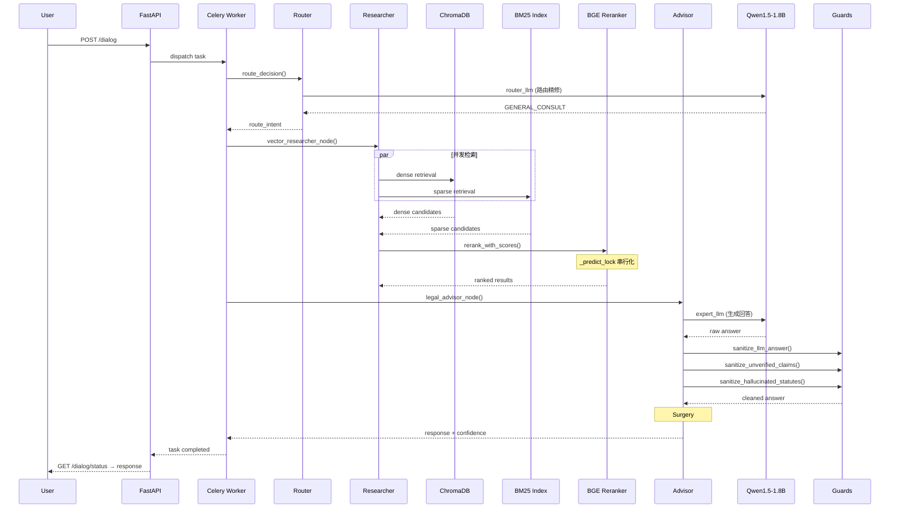
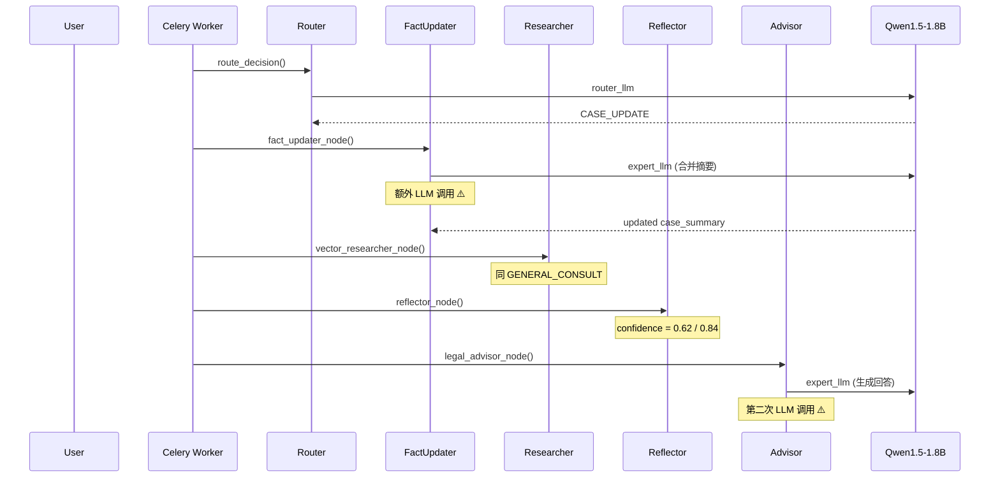

# Legal Agent V3 延迟分析报告

## 调用链时序分析

### GENERAL_CONSULT 路径
1. `tool_router_node` 路由判定
位置：[app/agent/nodes/router.py](C:/Users/123/Legal_Agent_V3/app/agent/nodes/router.py)
说明：非寒暄、非超范围输入会进入 `route_decision()`；在非纯启发式早退场景下，仍会调用 `router_llm` 做一次路由精修。

2. `vector_researcher_node` 检索与图谱加载
位置：[app/agent/nodes/researcher.py](C:/Users/123/Legal_Agent_V3/app/agent/nodes/researcher.py:17)
说明：
- 工具调用通过 `_execute_tool_calls()` 并发发起；
- 每个 law/case 工具内部又会进入 hybrid retrieval；
- 若存在 `conversation_id`，还会并发执行 `format_graph_memory()` 拉取会话图谱。

3. hybrid retrieval
位置：[app/agent/tools.py](C:/Users/123/Legal_Agent_V3/app/agent/tools.py:258), [app/agent/tools.py](C:/Users/123/Legal_Agent_V3/app/agent/tools.py:293), [app/agent/tools.py](C:/Users/123/Legal_Agent_V3/app/agent/tools.py:330), [app/agent/tools.py](C:/Users/123/Legal_Agent_V3/app/agent/tools.py:343)
说明：
- `_collect_query_candidates()` 对同一 query 并发执行 dense 检索和 BM25；
- `_merge_hybrid_candidates()` 会对扩展后的多个 query 再做一轮 `asyncio.gather()`；
- dense 和 sparse 结果汇合后再进入 reranker。

4. reranker
位置：[app/agent/tools.py](C:/Users/123/Legal_Agent_V3/app/agent/tools.py:67), [app/core/reranker.py](C:/Users/123/Legal_Agent_V3/app/core/reranker.py:46)
说明：
- `BGEReranker.rerank_with_scores()` 使用 `CrossEncoder.predict()`；
- 模型加载是 lazy init；
- 预测调用被 `_predict_lock` 串行化，多个请求会在这里排队。

5. `legal_advisor_node`
位置：[app/agent/nodes/advisor.py](C:/Users/123/Legal_Agent_V3/app/agent/nodes/advisor.py:342)
说明：
- `expert_llm` 再调用一次本地 Qwen；
- 生成后还会走三段后处理守卫，但这些守卫本身是纯 Python，CPU 成本远低于 LLM/RAG。

### CASE_UPDATE 路径
1. `tool_router_node`，同上。
2. `fact_updater_node`
位置：[app/agent/nodes/fact_updater.py](C:/Users/123/Legal_Agent_V3/app/agent/nodes/fact_updater.py:15)
说明：这里会额外调用一次 `expert_llm`，把旧摘要和新输入合并成净白摘要。

3. `vector_researcher_node`，同上。
4. `reflector_node`
位置：[app/agent/nodes/reflector.py](C:/Users/123/Legal_Agent_V3/app/agent/nodes/reflector.py:47)
说明：当前 reflector 是纯 Python，不是主要延迟来源。

5. `legal_advisor_node`
位置：[app/agent/nodes/advisor.py](C:/Users/123/Legal_Agent_V3/app/agent/nodes/advisor.py:342)
说明：再次调用 `expert_llm`。

结论：CASE_UPDATE 链路相较 GENERAL_CONSULT 至少多一次 `fact_updater` 的 LLM 调用，因此高分位延迟天然更高。

## 基准实测数据

数据来源：[final_benchmark_data.json](C:/Users/123/Legal_Agent_V3/e2e_tests/results/final_benchmark_data.json)

- 总请求数：36
- API 成功率：100%
- 平均端到端延迟：16957 ms
- P50：16546 ms
- P95：29531 ms
- 最大延迟：54558 ms
- 延迟分布：
  - 0-5s：0
  - 5-10s：7
  - 10-15s：6
  - 15-20s：14
  - 20-30s：5
  - 30s+：2

观测到两个显著现象：
1. 首个标准问题耗时 54558 ms，明显高于整体分布。
2. 测试开始时 `/system/status` 返回 `chroma=loading`, `llm=loading`, `celery=loading`，说明存在冷启动成本。

## 瓶颈识别

### 瓶颈 1：冷启动加载
证据：
- 基准测试首个请求耗时 54.6s；
- 同时系统状态显示 `chroma/llm/celery` 处于 `loading`。

判断：
- Chroma embedding、CrossEncoder reranker、本地 LLM 或 Celery worker 的首次激活构成了首请求尖峰；
- 这解释了 `max_latency` 远高于 `p95`。

### 瓶颈 2：RAG 混合检索 + rerank 链路过长
证据：
- `search_law_articles()` / `search_case_text()` 会执行 dense + BM25 双路召回；
- `_merge_hybrid_candidates()` 对扩展 query 列表再次并发召回；
- 最终结果统一经过 `BGEReranker.rerank_with_scores()`。

判断：
- 即使 dense/sparse 是并发的，候选集构建和 rerank 仍然带来明显 CPU 延迟；
- CrossEncoder 的 `_predict_lock` 还会把并发请求串行化，放大 P95。

### 瓶颈 3：CASE_UPDATE 链路额外多一次 LLM
证据：
- `fact_updater_node()` 使用 `expert_llm` 合并案情摘要；
- `legal_advisor_node()` 再次使用 `expert_llm` 输出最终回答。

判断：
- CASE_UPDATE 至少 2 次专家模型调用；
- 这也是剧本型多轮对话在 15-20s 区间密集分布的重要原因。

## 优化建议（按 ROI 排序）

1. 增加冷启动预热
预期收益：高
实施成本：低
建议：
- 服务启动完成后主动执行一次空检索 + 一次短 LLM 调用；
- 让 `ChromaManager`、`BGEReranker`、Qwen 推理后端和 Celery worker 进入热态；
- 这能直接削掉首请求的 30s+ 尖峰。

2. 降低 reranker 串行拥塞
预期收益：高
实施成本：中
建议：
- 降低 `CHROMA_RECALL_K / BM25_RECALL_K / top_k`；
- 在进入 CrossEncoder 前先做更激进的候选裁剪；
- 如果允许模型侧优化，可将高频基准测试切到更轻的 reranker 或做批量聚合推理。

3. 缩减 CASE_UPDATE 链路中的 LLM 次数
预期收益：中高
实施成本：中
建议：
- `fact_updater_node` 对“首轮建案”或“短补充”场景采用纯规则增量拼接；
- 仅在摘要冲突或事实纠正时再调用 LLM；
- 这样可让大量 CASE_UPDATE 从“两次 expert_llm”降为“一次 expert_llm”。

## 可立即实施的低风险优化

1. 预热脚本常驻化
把 `system/status` 之后的 warmup 动作写成启动 SOP，而不是人工手动触发。

2. 基准测试前强制热身
在 `e2e_tests/final_benchmark.py` 前增加 1-2 个丢弃样本，不计入论文结果，只用于拉热 embedding / reranker / LLM。

3. 记录分阶段耗时
在 router、fact_updater、researcher、advisor 入口出口增加结构化 timing log，下一轮能把“预估瓶颈”升级为“真实节点耗时占比”。

## 附录：调用链时序图（Mermaid）

### GENERAL_CONSULT 路径

### CASE_UPDATE 路径

